# PubQuizPython

The Python service of a pub quiz platform, built as part of my master's thesis
*"Development of a software solution for creating an interactive platform intended for automated quiz management"*
(Algebra Bernays University, Zagreb, 2026).

It does two things that the rest of the platform delegates to Python:

- **Personalized quiz recommendations**: matches users with upcoming quiz editions.
- **Automated grading of handwritten answer sheets**: a pipeline of three neural networks reads question numbers and handwritten answers from a photo of a team's answer sheet.

## The platform

Pub quizzes are weekly trivia events held in bars, usually played in teams. Existing platforms mostly work as event directories. They don't recommend quizzes based on a player's interests, measure a player's knowledge, or keep an archive of past quizzes, and grading paper answer sheets between rounds is slow and tedious for the organizer.

The platform addresses this with:

- an **Elo-based rating system**, adapted from one-on-one matches to many teams per quiz, that rates both players and quizzes
- **recommendations** based on a user's history and rating
- **automated answer grading** with computer vision, to shorten the wait between rounds and archive the answers

It is a distributed, multi-tier system:

| Component | Technology |
|---|---|
| Backend API (business logic, auth, ratings) | ASP.NET Core (.NET 9), Entity Framework |
| Organizer and attendee frontends | Blazor WebAssembly |
| Media server | ASP.NET Core |
| Database | PostgreSQL |
| **Recommendation / computer vision API (this repository)** | **Python, FastAPI, PyTorch, OpenCV, Ultralytics YOLO** |

## API

| Endpoint | Caller | Description |
|---|---|---|
| `POST /recommendations` | Backend API (JWT protected) | Generates recommendation scores for a quiz edition |
| `POST /sentence` | Quiz organizer | Accepts a photo of an answer sheet and returns the recognized question numbers and answers |

The service has read-only access to the two tables holding user and edition profiles, and read/write access to the table holding the recommendations.

## Recommender system

Recommendations are **content-based**. Matrix factorization was considered, but it needs historical ratings of items, and here every user attends a quiz edition at the same time, so that history never exists.

Instead, each user and each quiz edition has a profile with eight features, chosen from the results of a survey of quiz attendees: rating, categories, location, organization, duration, team count and size, day of the week and time. For each feature, a score from 0 to 1 measures how close the edition is to the user's preference. The weighted scores are combined into a single match score from 0 to 1, with rating and categories weighted highest.

Recommendations are generated only for users who logged in within the past week and are within 20 km of the edition's location.

## OCR pipeline: reading handwritten answers

```
photo of answer sheet
  → preprocessing (OpenCV)
  → segmentation CNN          finds the answer regions (pixel masks)
  → YOLOv11n object detection classifies the question number / answer / multiple choice
  → CRNN + CTC                transcribes the handwriting to text
  → JSON to the backend for grading
```

All three models were trained on an NVIDIA RTX 3070; training on the GPU was about 23× faster than on the CPU.

### 1. Dataset and preprocessing

The dataset consists of photos of **20 answer sheets** (3 rounds × 12 answers each). They were printed and filled out by several people to get a variety of handwriting.

Preprocessing has two versions. The first (grayscale → median blur → adaptive thresholding → removal of small contours) produces clean binary images from phone photos. Images uploaded through the browser arrive at a lower resolution, though, and this version either left noise or erased parts of letters. The second version uses non-local means denoising and **CLAHE** contrast enhancement instead. Both resize the image and pad it to 640×640 so the handwriting isn't distorted.

<p align="center">
  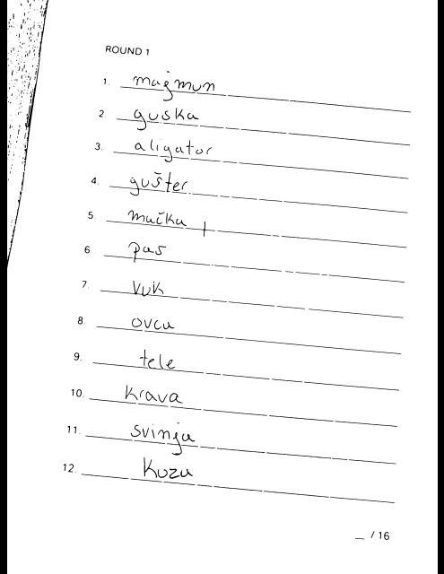
  &nbsp;&nbsp;
  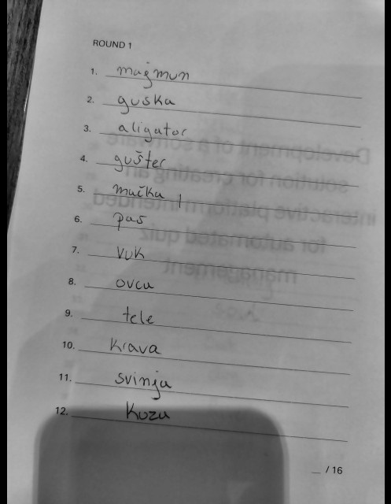
  <br><em>Left: first cleaning function (binary). Right: second cleaning function (denoising + CLAHE).</em>
</p>

**Segmentation masks.** Bounding boxes can't separate neighbouring answers whose ascenders (t, l, d) and descenders (p, q, y) overlap, so the segmentation model uses pixel-level masks. Drawing masks by hand in Label Studio took too long, so a script ([`OCR/create_mask.py`](OCR/create_mask.py)) generates them from the binary images, adding a pixel buffer that links the question number to its answer line. The remaining overlaps were then fixed by hand. Rotating images and masks by up to ±15° ([`rotate_image_and_mask.py`](OCR/detection/rotate_image_and_mask.py)) made the dataset five times larger.

<p align="center">
  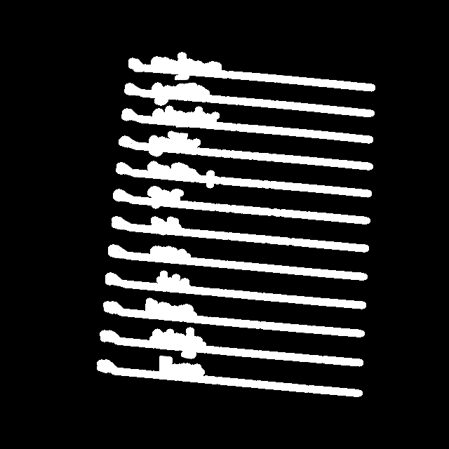
  <br><em>Ground-truth mask for the segmentation model</em>
</p>

**Detection labels.** The extracted answer regions (512×64) were labelled in Label Studio in YOLO format with three classes: `number`, `answer` and `multiple` (multiple choice).

<p align="center">
  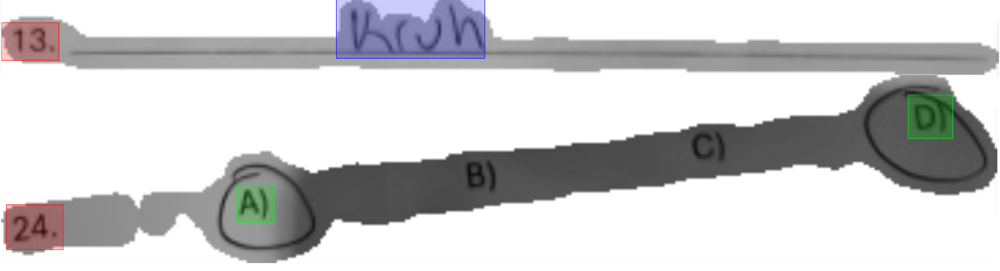
  <br><em>Bounding box annotation: red is the number, blue the answer, green multiple choice</em>
</p>

Cropping the labelled boxes produced the final OCR dataset of **1,299 images**, each transcribed by hand.

### 2. Segmentation model

A custom fully convolutional network in PyTorch ([`OCR/detection/sentence_model.py`](OCR/detection/sentence_model.py)). It has three convolution and max-pooling stages (64 → 128 → 256 channels), two refinement convolutions, dropout, ×8 bilinear upsampling back to the input size, and a sigmoid that outputs a per-pixel probability of "answer region". It was trained with binary cross-entropy and the Adam optimizer (learning rate 0.001), saving the model whenever the validation loss improved, with early stopping.

After 70 epochs, the best validation loss was **0.095** (epoch 67). Training and validation loss stayed close together throughout.

<p align="center">
  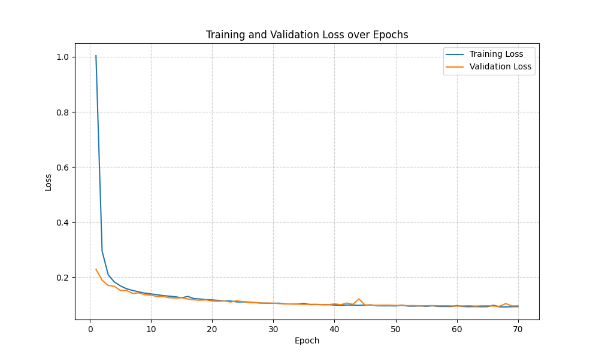
</p>

On a sheet the model had never seen, uploaded through the organizer frontend, it finds the answer regions and ignores other text such as "ROUND 2" and the points field:

<p align="center">
  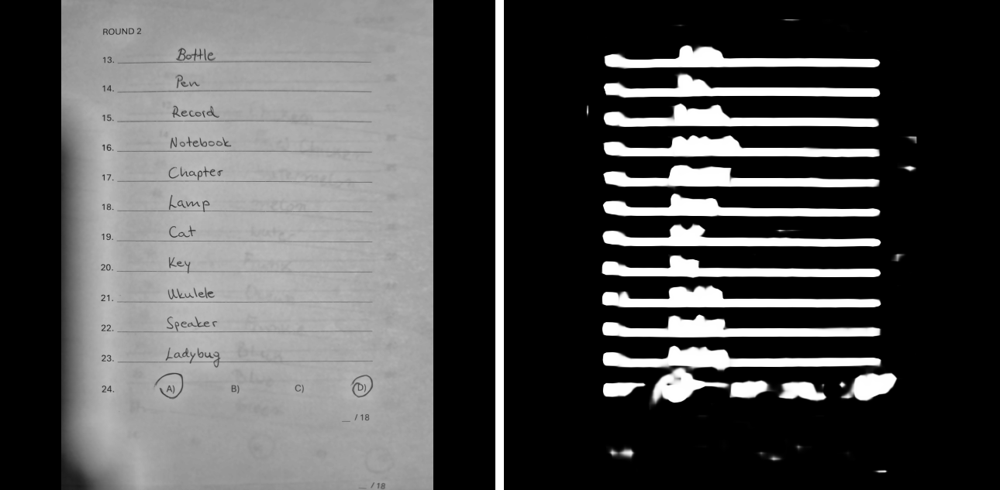
</p>

Answers whose letters were close together tended to merge into a single region. Weighting the BCE loss by the ratio of answer pixels to background pixels fixed this, leaving only faint grey traces (left image below). Multiple-choice answers are still a weak spot (right image). They make up only 1 of 36 questions and have no answer line, so the model finds their parts but doesn't connect them.

<p align="center">
  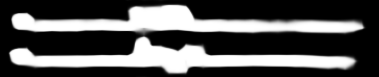
  &nbsp;&nbsp;
  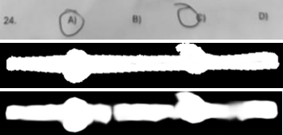
</p>

### 3. Object detection model (YOLOv11n)

Each answer region is passed to **YOLOv11n** (Ultralytics, nano variant) to locate the question number and the answer ([`OCR/classifier/classifier_model.py`](OCR/classifier/classifier_model.py)). A region is passed on only if it contains exactly one question number, so answers can't be assigned to the wrong question. The model was trained for 100 epochs with image size 512 and batch size 64.

mAP@50-95 rose above 0.6 within the first 25 epochs and settled between **0.7 and 0.8**:

<p align="center">
  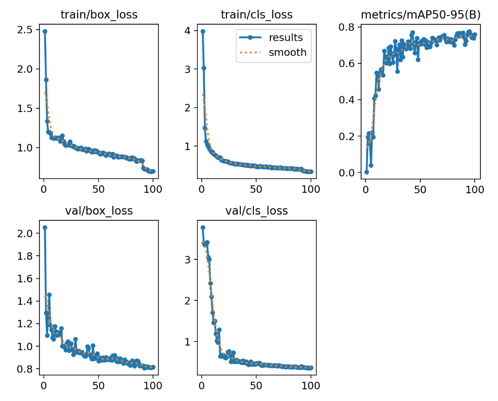
</p>

<p align="center">
  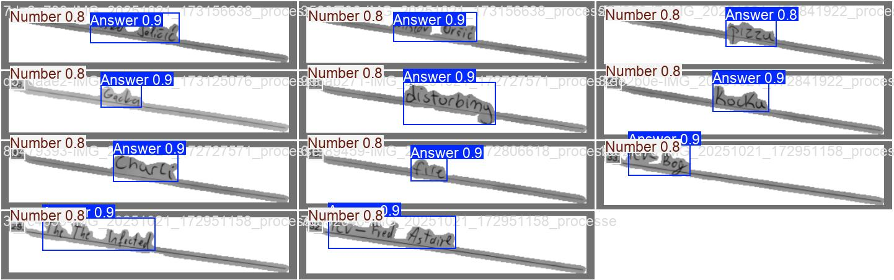
  <br><em>Predictions on validation images (confidence 0.8–0.9)</em>
</p>

### 4. Handwriting recognition (CRNN + CTC)

A convolutional recurrent neural network ([`OCR/ocr/crnn_ocr.py`](OCR/ocr/crnn_ocr.py)). A CNN with batch normalization reduces each image to a sequence of feature vectors along its width. A 2-layer bidirectional LSTM reads that sequence, and a fully connected layer predicts a character at each step. It is trained with **CTC loss**, so labels don't need to be aligned with positions in the image. The character set includes Croatian letters (č, ć, đ, š, ž). Accuracy is measured with a similarity score based on Levenshtein distance.

This is the weakest part of the pipeline. 1,299 images are too few for this many character classes. A synthetic dataset of 20,000 words rendered in handwriting-style fonts ([`synth generator.py`](OCR/ocr/dataset/external/synth%20generator.py)) trained well, but the model didn't generalize to real handwriting. Trained on real handwriting, the model started overfitting around epoch 100: training loss approached 0 while validation loss stayed around 1.7. Similarity peaked at **66%**.

<p align="center">
  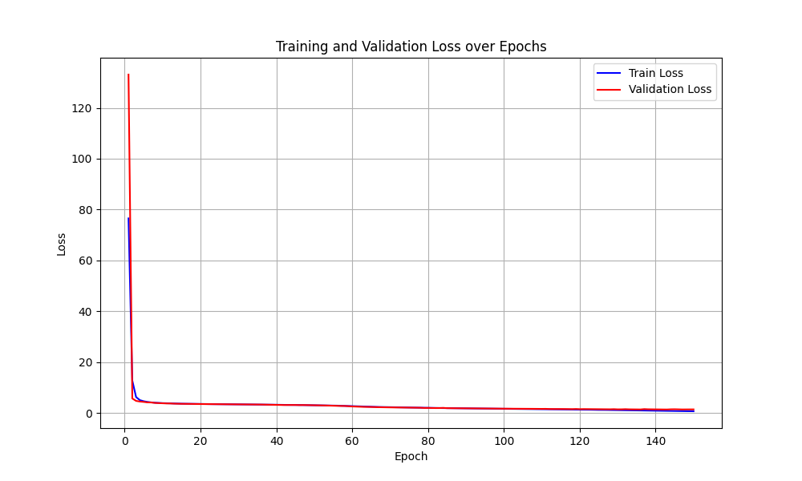
  &nbsp;
  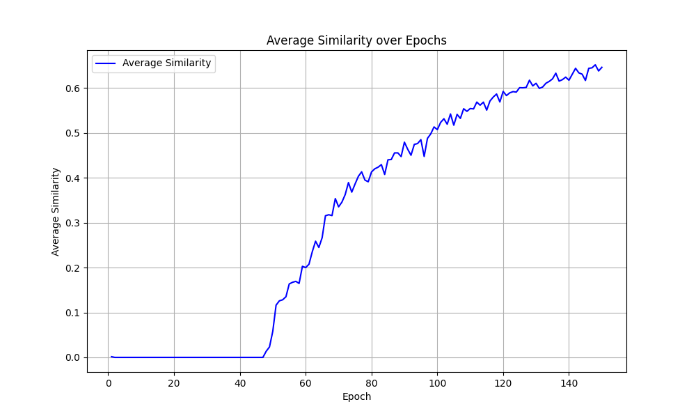
</p>

Short, common strings such as question numbers are recognized reliably. Results on handwritten words vary from close to completely wrong:

<p align="center">
  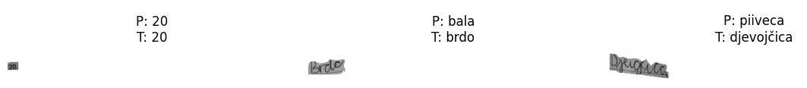
  <br><em>P = prediction, T = ground truth</em>
</p>

### Limitations and next steps

- **Data.** The main limit is the size of the dataset. Collecting and annotating it by hand is slow for one person, and the CRNN overfits as a result. More real handwriting samples, or pretraining on a public handwriting dataset (e.g. IAM), would be the next step.
- **Multiple choice.** Multiple-choice answers need more examples, or their own detection path.

## Project structure

```
main.py                  FastAPI app: loads the models and defines the endpoints
dependencies.py          Database session dependency
database/                SQLAlchemy (async) models and repository
recommendation/          Content-based recommendation scoring
misc/                    Request DTOs
OCR/
  prepare_image.py       Image cleaning / preprocessing (OpenCV)
  create_mask.py         Mask generation for segmentation training data
  detection/             Segmentation CNN, training, mask region extraction,
                         experimental oriented bounding box detector
  classifier/            YOLOv11n training and detection
  ocr/                   CRNN model, training, sentence preprocessing,
                         synthetic handwriting data generator
```

## Running locally

Requires Python 3.12 and an NVIDIA GPU with CUDA 12.1 (PyTorch `2.5.1+cu121`). The service also runs on the CPU, but more slowly.

```bash
python -m venv .venv
.venv\Scripts\activate
pip install -r requirements.txt
uvicorn main:app --reload
```

Environment variables (`.env`):

```
DB_USER=
DB_PASSWORD=
DB_HOST=
DB_PORT=
DB_NAME=
SECRET=        # JWT signing key, shared with the backend API
ALGORITHM=     # JWT algorithm
```

The trained weights and datasets are not included in the repository. `main.py` expects:

- `OCR/detection/small_sentence_model.pth`: segmentation model
- `OCR/classifier/runs/yolo/weights/best.pt` and `OCR/classifier/data/classes.txt`: YOLO model
- `OCR/ocr/best_small_ocr_model.pth`: CRNN model
